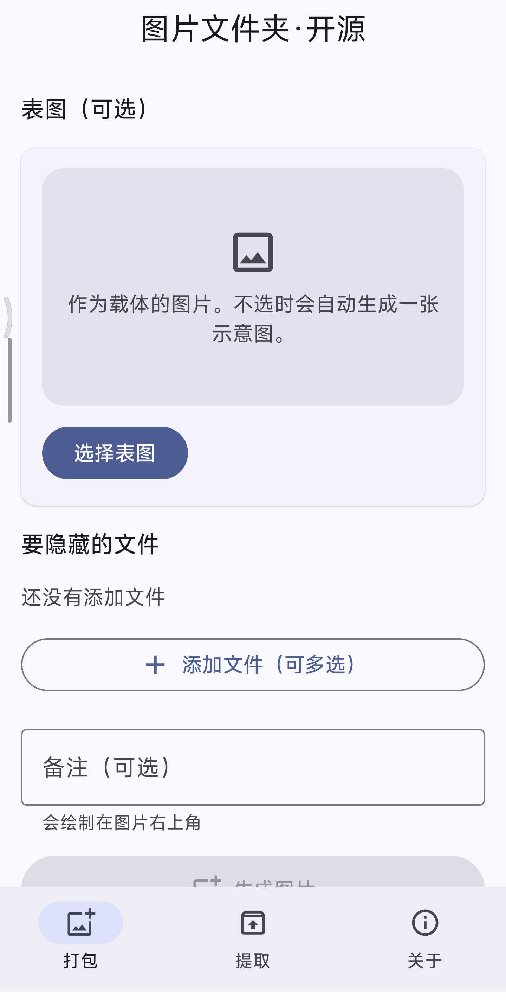
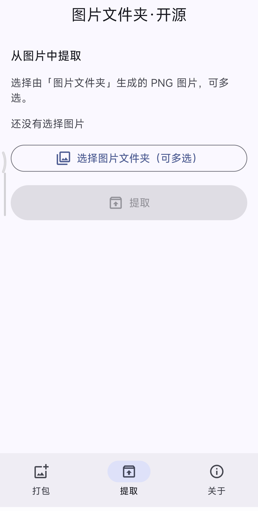

# 图片文件夹 · 开源版

把任意文件藏进 PNG 图片的 Android 工具。界面使用 **Jetpack Compose + Material Design 3** 重写，数据格式与原版「图片文件夹」v1.1 **完全兼容**。

> 本项目是针对已停止维护的原应用「图片文件夹」的独立开源重实现。代码与素材全部重写，不包含原应用的任何代码或资源。

<p align="center">
  
  
  
</p>

## 功能

- **打包**：选择可选的表图（载体图片）、添加任意多个要隐藏的文件、可写一段备注
  - 不选表图时自动生成一张示意图片
  - 备注会绘制在图片右上角
  - 输出文件名沿用原版风格：`Tank_20261115_123456.png`
- **提取**：多选 PNG 图片，自动识别其中的隐藏文件
  - 图片可直接预览
  - 单个保存或全部保存
  - 非图片文件保存后可调用系统应用打开
- **兼容模式**：仅从相册单选一张图片，适配选择器异常的设备
- **Material 3**：动态取色、深色模式、Edge-to-Edge

## 数据格式

隐藏数据写入 PNG 的私有 ancillary chunk（4 字符名称 `tpWj`）：

```
PNG 签名
IHDR
tpWj  <- 文件 1：{"name":"文件名","mime":"类型"} 0x00 <原始字节>
tpWj  <- 文件 2：...
IDAT
IEND
```

- chunk 长度与 CRC32 按 PNG 规范使用大端序
- 每个隐藏文件一个 chunk，插入在第一个 `IDAT` 之前
- 普通看图软件会忽略未知 chunk，图片仍可正常显示
- 与原版生成的图片可以互相打开

详见 [docs/REVERSE_ENGINEERING.md](docs/REVERSE_ENGINEERING.md)。

## 下载

从 [Releases](https://github.com/visionjam/imagefolder-open/releases) 下载最新签名的 APK。

## 构建

要求：

- JDK 17 或更高
- Android SDK Platform 35、Build-Tools 35.0.0

```bash
./gradlew assembleDebug
```

仓库的 `settings.gradle.kts` 已优先配置阿里云 Maven 镜像，Gradle wrapper 默认使用腾讯云镜像（见 `gradle/wrapper/gradle-wrapper.properties`），国内网络可直接构建。海外网络可自行调整仓库顺序或换回 Gradle 官方下载地址。

## 测试

```bash
./gradlew testDebugUnitTest
```

单元测试覆盖：

- chunk 编解码往返（文件名、MIME、二进制内容）
- 输出仍是合法 PNG（`ImageIO` 校验）
- 读取原版布局的 chunk
- 读取 Python 参考实现生成的互操作样张
- 损坏数据与非法输入

## 项目结构

```
app/src/main/java/com/imagefolder/open/
├── core/PngChunkCodec.kt      # 纯 Kotlin 的 tpWj chunk 读写
├── core/ImageProcessor.kt     # 封面解码、备注绘制、PNG 编码
├── data/GallerySaver.kt       # MediaStore 保存
├── data/UriUtils.kt           # 内容 URI 读取
├── MainViewModel.kt           # 状态与业务编排
└── ui/                        # Compose Material 3 界面
```

## 已知限制

- 需要 Android 10（API 29）及以上
- 打包时会把载荷文件完整读入内存，超大文件（数百 MB）可能导致内存不足
- 图片型载荷保存到 `Pictures/图片文件夹`，其他类型保存到 `Download/图片文件夹`

## 免责声明

本应用仅供技术研究与个人备份使用。请勿用于传播违法内容或侵犯他人权益，使用者的行为及后果由使用者自行承担。

## License

MIT
