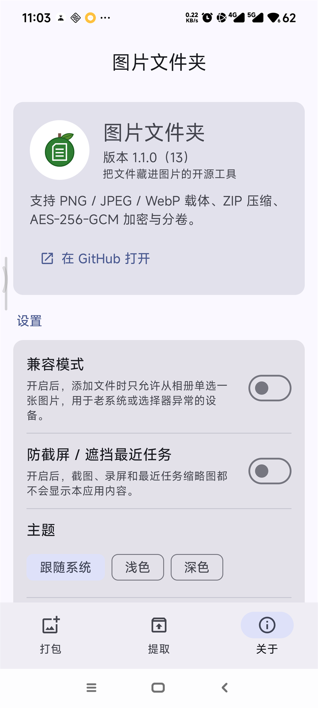

# Image Folder

[English](README.md) | [简体中文](README.zh-CN.md)

An Android tool that hides any file inside PNG, JPEG or WebP images. The UI is built with **Jetpack Compose + Material Design 3** and remains compatible with the data format of the original "Image Folder" app.

> An independent open-source reimplementation of the discontinued Image Folder app. All code and assets were rewritten; it contains no code or resources from the original app.
>
> Current version: **v0.5.1** · [Changelog](CHANGELOG.md)

<p align="center">
  
  
  
</p>

## Features

- **Pack**: choose an optional cover image, add any number of files, and write a note
  - Generates a green apple placeholder cover when no cover is selected
  - Draws the note in the top-right corner
  - Output format follows the cover: PNG / JPEG / WebP are preserved; HEIC/AVIF and other containers are converted to PNG
  - Output names follow the original style: `Tank_20261115_123456.png` / `.jpg` / `.webp`
- **Folders**: add whole directories through the system picker; directory structure and empty folders are preserved
- **Compression**: ZIP Deflate to reduce payload size
- **Encryption**: AES-256-GCM + PBKDF2-HMAC-SHA256 (600,000 iterations); a password is required for extraction. Older bundles are read with the iteration count stored in their header.
- **Extract**: select multiple PNG / JPEG / WebP images and automatically detect hidden content
  - Preview images directly
  - Save one item or all items to the gallery
  - Open non-image files after saving
  - Export to a folder while preserving the directory structure
- **Unpack**: archives in extraction results can be unpacked in-app
  - ZIP (ZipCrypto / AES passwords), 7z (password)
  - TAR, GZ, BZ2, XZ (including `.tar.gz` / `.tar.bz2` / `.tar.xz`)
  - Split ZIP (`.z01`… + `.zip` or `.zip.001`…) and split 7z (`.7z.001`…)
  - Preserves directory structure; nested archives can be unpacked recursively; missing split parts are listed
  - RAR is not supported
- **Languages and themes**: follow the system or choose Simplified Chinese / English; themes support system / light / dark
- **Compatibility mode**: pick a single image from the gallery for devices with picker issues
- **Material 3**: dynamic color, dark mode, edge-to-edge

### Format compatibility

| Carrier / mode | This app | Original Image Folder v1.1 |
| --- | --- | --- |
| PNG, no compression / encryption / folders | ✅ | ✅ extractable |
| PNG, compressed / encrypted / with folders | ✅ | ❌ only sees a `.zip` payload |
| JPEG (any mode) | ✅ | ❌ not recognized |
| WebP (any mode) | ✅ | ❌ not recognized |

PNG output without advanced features still writes the original per-file `tpWj` chunks, so basic usage is fully interoperable; advanced features use the v0.2 `IFB2` envelope. JPEG/WebP carriers use private segments/chunks in their containers and can only be read by this app.

## Privacy

- **No network permission.** The app does not request `INTERNET`; there are no analytics, accounts, or cloud services.
- **All local.** Packing, extraction and decryption run entirely on the device. Nothing is uploaded.
- **What encryption protects.** An encrypted bundle hides the payload contents and inner file names. It does **not** hide the fact that the image contains hidden data, the entry count, or the carrier image itself.
- **Transit risk.** Chat and social apps may recompress images or strip unknown chunks/segments. Send the image as a file when possible; the recipient needs this app to extract it.
- **Password loss is unrecoverable.** Passwords are never stored.
- See [SECURITY.md](SECURITY.md) for the threat model and [docs/FORMAT.md](docs/FORMAT.md) for the on-disk format.

## Data format

All three carriers share the same `JSON header + 0x00 + raw bytes` payload:

- **PNG**: private ancillary chunk (`tpWj`), inserted before the first `IDAT`
- **JPEG**: APP15 (`0xFFEF`) segments inserted before the first SOS; payloads larger than 64KB are split automatically
- **WebP**: private RIFF chunk `IFBW`, appended after the image chunks

```
PNG signature
IHDR
tpWj  <- file 1: {"name":"file name","mime":"type"} 0x00 <raw bytes>
tpWj  <- file 2: ...
IDAT
IEND
```

v0.2 ZIP / encrypted payloads use the `IFB2` envelope in the same payload. See [docs/FORMAT.md](docs/FORMAT.md) for details and [docs/ARCHIVES.md](docs/ARCHIVES.md) for archive support.

- PNG chunk lengths and CRC32 are big-endian per the PNG spec; JPEG segment lengths are big-endian and WebP chunk lengths are little-endian
- Regular image viewers ignore unknown chunks / APP15 segments, so the image still renders normally

## Download

Download the latest signed APK from [Releases](https://github.com/visionjam/imagefolder-open/releases).

## Build

Requirements:

- JDK 17 or newer
- Android SDK Platform 35, Build-Tools 35.0.0

```bash
./gradlew assembleDebug
./gradlew assembleRelease   # R8 + resource shrinking, ~3 MB output
```

The repository's `settings.gradle.kts` prefers Aliyun Maven mirrors, and the Gradle wrapper uses a Tencent Cloud mirror by default (see `gradle/wrapper/gradle-wrapper.properties`), so builds work from mainland China. Outside China, adjust the repository order or switch back to the official Gradle distribution URL.

## Tests

```bash
./gradlew testDebugUnitTest
```

Unit tests cover:

- `tpWj` chunk round-trips and PNG structure / CRC validation
- Reading the original layout and interoperability fixtures from the Python reference implementation
- JPEG APP15 segment write / extract and automatic splitting above 64KB
- WebP RIFF chunk write / extract, odd-sized chunks and padding
- ZIP directory structure, compression and empty-folder preservation
- AES-256-GCM encryption / decryption, wrong passwords, random salt / nonce
- Path traversal and malicious ZIP protection
- Corrupt data and invalid input

Currently **45 JVM unit tests + 6 on-device tests**.

On-device end-to-end tests (requires a connected device):

```bash
./gradlew connectedDebugAndroidTest
```

See [docs/RELEASING.md](docs/RELEASING.md) for the release process.

## Project layout

```
app/src/main/java/com/imagefolder/open/
├── core/PngChunkCodec.kt      # tpWj chunk I/O (PNG carrier)
├── core/JpegCarrierCodec.kt   # APP15 segment I/O (JPEG carrier)
├── core/WebpCarrierCodec.kt   # IFBW chunk I/O (WebP carrier)
├── core/CarrierCodec.kt       # carrier detection and dispatch
├── core/HiddenPayloadCodec.kt # shared JSON header + payload
├── core/BundleCodec.kt        # ZIP + AES-256-GCM envelope
├── core/BundlePaths.kt        # safe, unique archive paths
├── core/ArchiveExtractor.kt   # ZIP/7z/TAR/GZ/BZ2/XZ extraction
├── core/ImageProcessor.kt     # cover decoding, note drawing, PNG/JPEG/WebP encoding
├── data/FolderReader.kt       # SAF directory traversal, structure preservation
├── data/FolderExporter.kt     # export with directory structure
├── data/GallerySaver.kt       # MediaStore saving
├── data/UriUtils.kt           # content URI reading
├── MainViewModel.kt           # state and business orchestration
└── ui/                        # Compose Material 3 UI
```

## Known limitations

- Requires Android 10 (API 29) or newer
- Payload files are read fully into memory while packing; very large files (hundreds of MB) may cause out-of-memory errors
- JPEG / WebP carriers are re-encoded at quality 95 (EXIF and other metadata are dropped); PNG output is lossless
- JPEG / WebP carriers can only be extracted by this app; the original Image Folder v1.1 only reads PNG
- Passwords are not stored; a lost password cannot be recovered
- RAR, split RAR, ISO / CAB / DEB / RPM and ZSTD are not supported
- Split archives must all be present in the current extraction results (same batch of images / envelopes); missing parts are not searched on the device
- Image payloads are saved to `Pictures/图片文件夹`; other files go to `Download/图片文件夹`. Use "Export to folder" for the full directory structure
- Switching between Release and debug builds requires an uninstall because the signatures differ

## Disclaimer

This app is intended for technical research and personal backup only. Do not use it to distribute illegal content or infringe the rights of others. You are responsible for your actions and their consequences.

## Acknowledgements

- Archive format and library choices were informed by [ZipXtract](https://github.com/WirelessAlien/ZipXtract) (GPL-3.0)
- Uses Apache Commons Compress, XZ for Java (public domain), Zip4j and other open-source libraries

## License

Copyright (C) 2026 Vision Jam

This project is licensed under the **GNU General Public License v3.0**; see [LICENSE](LICENSE).
