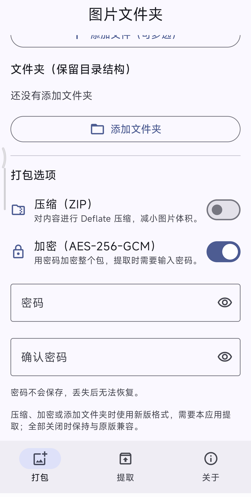
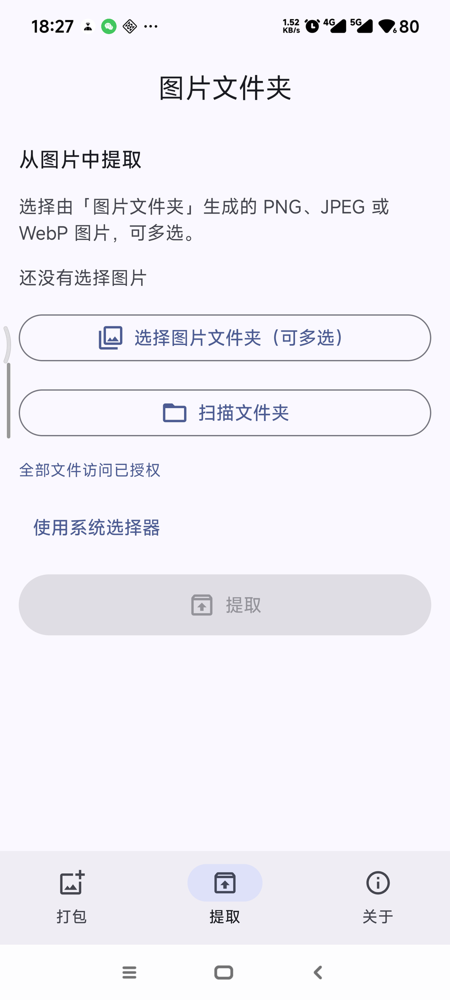
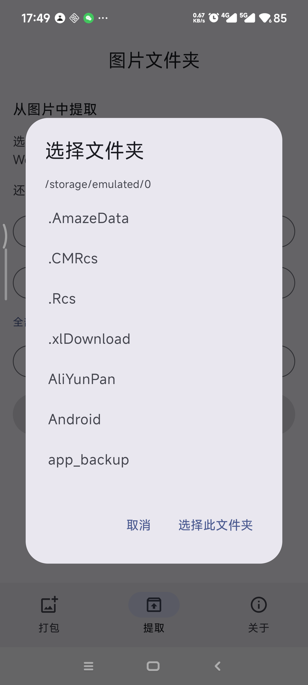
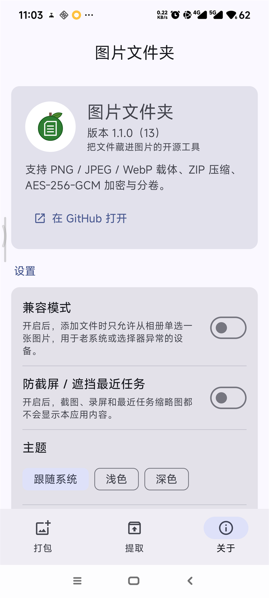

# 图片文件夹

[English](README.md) | [简体中文](README.zh-CN.md)

把任意文件藏进 PNG / JPEG / WebP 图片的 Android 工具。界面使用 **Jetpack Compose + Material Design 3** 实现，兼容原版「图片文件夹」的数据格式。

> 本项目是针对已停止维护的原应用「图片文件夹」的独立开源重实现。代码与素材全部重写，不包含原应用的任何代码或资源。
>
> 当前版本：**v1.1.0**（本地构建，待真机验证） · [更新日志](CHANGELOG.md)

<p align="center">
  
  
  
  
</p>

## 功能

- **打包**：选择可选的表图（载体图片）、添加任意多个文件、可写一段备注
  - 不选表图时自动生成绿色苹果示意图
  - 备注会绘制在图片右上角
  - 输出格式跟随表图：PNG / JPEG / WebP 原样保留，HEIC/AVIF 等转为 PNG
  - 输出文件名默认沿用原版风格（`Tank_20261115_123456.png` / `.jpg` / `.webp`），也可以在打包页自定义；扩展名始终跟随表图格式
- **文件夹**：通过系统目录选择器添加整个文件夹，保留目录结构与空目录
- **压缩**：ZIP Deflate 压缩，减小载荷体积
- **加密**：AES-256-GCM + PBKDF2-HMAC-SHA256（600,000 次），提取时需要密码；旧版生成的包仍按头部记录的迭代次数读取
- **分卷图种**：打包时可把一份图种拆成 1–9 张图片，适合聊天平台 / 图床限制单图大小的场景
  - 每张都是可正常查看的图片，各带一段数据和随机组号；分卷使用新版格式
  - 分卷时表图最长边限制为 1280 px，避免每份重复携带大图
  - 提取时把同一组图片一起选中即可，顺序不限；缺份、重复或数据损坏都会给出提示
- **提取**：多选 PNG / JPEG / WebP 图片，自动识别其中的隐藏内容
  - 结果按文件夹逐层浏览：文件夹行可以点进去，左上角返回上一级
  - 图片和纯文本文件可直接预览
  - 单个保存或全部保存到相册
  - 任意格式都可以「用其他应用打开」（未保存的条目会先写入缓存）；系统已关联默认应用时直接打开，没有默认应用时由系统弹出「打开方式」
  - 按目录结构「导出到文件夹」
- **文件夹扫描**：递归扫描选中的文件夹，列出 PNG / JPEG / WebP 中含隐藏内容的图片，可逐张勾选后加入提取，也可一键全部加入
- **全部文件访问（可选）**：在系统设置授权后，可浏览并扫描内置存储根目录、Download 等系统选择器无法进入的普通目录
- **解压**：提取结果中的压缩包可直接解压
  - ZIP（ZipCrypto / AES 密码）、7z（密码）
  - TAR、GZ、BZ2、XZ（含 `.tar.gz` / `.tar.bz2` / `.tar.xz`）
  - 分卷 ZIP（`.z01`… + `.zip` 或 `.zip.001`…）与分卷 7z（`.7z.001`…）
  - RAR：无密码 RAR5（含固实、分卷）与非固实 RAR4（含 `.rar` + `.r00`… 和 `.partN.rar` 分卷）
  - 保留目录结构；嵌套压缩包可继续解压；缺少分卷时列出缺失文件
  - 加密 RAR（密码/加密头）与固实 RAR4 暂不支持
- **分享进来**：从其他应用分享文件或图片；普通文件进入打包页，含隐藏内容的图片可选择提取或打包
- **分享出去**：生成结果可直接分享；首次会提示聊天平台可能重压缩、导致隐藏数据丢失
- **多语言与主题**：语言可跟随系统或手动选择简体中文 / English；主题同样支持跟随系统 / 浅色 / 深色
- **缓存自动清理**：启动时清理 3 天前或超过 64 MB 的临时文件（分享导入副本、分享副本、解压临时文件），关于页显示当前占用并可一键清理
- **兼容模式**：仅从相册单选一张图片，适配选择器异常的设备
- **Material 3**：动态取色、深色模式、Edge-to-Edge

### 格式兼容性

| 载体 / 打包方式 | 本应用 | 原版「图片文件夹」v1.1 |
| --- | --- | --- |
| PNG，不压缩、不加密、无文件夹 | ✅ | ✅ 可提取 |
| PNG，压缩 / 加密 / 含文件夹 | ✅ | ❌ 只能看到一个 `.zip` 数据块 |
| 分卷图种（IFSP，任意载体） | ✅ | ❌ 每份只能看到一个不完整的 `.zip` |
| JPEG（任意模式） | ✅ | ❌ 不识别 |
| WebP（任意模式） | ✅ | ❌ 不识别 |

PNG 未启用高级特性时仍写入原版的逐个 `tpWj` chunk，因此基础用法完全互通；高级特性使用 v0.2 的 `IFB2` 封装。JPEG / WebP 载体使用各自容器中的私有段/块，只有本应用能读取。

## 隐私

- **无网络权限**：应用不申请 `INTERNET` 权限，没有统计、账号或云端服务。
- **全部本地完成**：打包、提取和解密都在设备上进行，不上传任何文件。
- **加密保护什么**：加密包隐藏载荷内容与内层文件名；但**不隐藏**「这张图里有数据」这一事实、条目数量，也不隐藏载体图片本身。
- **传输风险**：聊天和社交平台可能重新压缩图片或剥离未知 chunk/段。尽量以「文件」形式发送；接收方需要安装本应用才能提取。
- **「全部文件访问」是可选项**：仅用于浏览系统选择器无法进入的普通目录；应用仍不上传任何文件。
- **密码丢失不可恢复**：密码不会被保存。
- 威胁模型见 [SECURITY.md](SECURITY.md)，磁盘格式见 [docs/FORMAT.md](docs/FORMAT.md)。

## 数据格式

三种载体共用同一份 `JSON 头 + 0x00 + 原始字节` 载荷：

- **PNG**：写入私有 ancillary chunk（4 字符名称 `tpWj`），位置在第一个 `IDAT` 之前
- **JPEG**：写入 APP15（`0xFFEF`）段，插入在第一个 SOS 之前；超过 64KB 时自动拆分为多个段
- **WebP**：写入私有 RIFF chunk `IFBW`，追加在图像数据之后

```
PNG 签名
IHDR
tpWj  <- 文件 1：{"name":"文件名","mime":"类型"} 0x00 <原始字节>
tpWj  <- 文件 2：...
IDAT
IEND
```

v0.2 的 ZIP / 加密内容使用 `IFB2` 封装写入同一个载荷；分卷图种把 `IFB2` 切成多段，每段再加一个 `IFSP` 段头（组号、序号、总长、SHA-256、CRC32），详见 [docs/FORMAT.md](docs/FORMAT.md)。压缩包解压支持见 [docs/ARCHIVES.md](docs/ARCHIVES.md)。

- PNG chunk 长度与 CRC32 按 PNG 规范使用大端序；JPEG/WebP 的分段长度分别使用大端/小端序
- 普通看图软件会忽略未知 chunk / APP15 段，图片仍可正常显示

## 下载

每个版本发两个签名包，按手机选一个：

| 文件 | 内容 | 什么时候用 |
| --- | --- | --- |
| `imagefolder-open-vX.Y.Z-arm64-v8a.apk` | 只含 64 位 ARM（约 5.5 MB） | 近几年的大多数手机，体积更小 |
| `imagefolder-open-vX.Y.Z-universal.apk` | `arm64-v8a` + `armeabi-v7a`（约 7.4 MB） | 老的 32 位 ARM 设备 |

两个包用同一把密钥签名，可以互相覆盖升级，也能覆盖旧版本。每个包都附带 `.sha256` 文件。

## 构建

要求：

- JDK 17 或更高
- Android SDK Platform 35、Build-Tools 35.0.0

```bash
./gradlew assembleDebug
./gradlew assembleRelease   # R8 + 资源收缩，当前产物约 7MB（含 RAR native 库）
```

仓库的 `settings.gradle.kts` 已优先配置阿里云 Maven 镜像，Gradle wrapper 默认使用腾讯云镜像（见 `gradle/wrapper/gradle-wrapper.properties`），国内网络可直接构建。海外网络可自行调整仓库顺序或换回 Gradle 官方下载地址。

## 测试

```bash
./gradlew testDebugUnitTest
```

单元测试覆盖：

- `tpWj` chunk 编解码往返与 PNG 结构 / CRC 校验
- 读取原版布局与 Python 参考实现生成的互操作样张
- JPEG APP15 分段写入/提取、超过 64KB 的自动拆分
- WebP RIFF chunk 写入/提取、奇数长度 chunk 与填充
- PNG / JPEG / WebP 流式载体探测：元数据、旧格式 chunk 计数、跳过载荷、截断与畸形输入
- ZIP 目录结构、压缩与空目录保留
- AES-256-GCM 加解密、错误密码、随机盐/nonce
- 路径穿越与恶意 ZIP 防护
- ZIP / 7z / TAR / GZ / BZ2 / XZ 格式识别与解压
- 分卷分组（`.z01`… + `.zip`、`.zip.001`…、`.7z.001`…、`.rar` + `.r00`…、`.partN.rar`）与缺失分卷报告
- RAR 后端注入与 libarchive 错误映射（加密、固实 RAR4、截断、不支持特性）
- 文件夹遍历、分享分类与合并去重
- 分卷图种的拆分 / 重组、任意顺序、缺份报告、跨组混用、重复份、CRC 与 SHA-256 校验，以及 PNG/JPEG/WebP 三种载体的分卷往返
- 损坏数据与非法输入

当前共 **123 个 JVM 单元测试 + 16 个真机用例**。

真机端到端测试（需要连接设备）：

```bash
./gradlew connectedDebugAndroidTest
```

发版流程见 [docs/RELEASING.md](docs/RELEASING.md)。

## 项目结构

```
app/src/main/java/com/imagefolder/open/
├── core/PngChunkCodec.kt          # tpWj chunk 读写（PNG 载体）
├── core/JpegCarrierCodec.kt       # APP15 分段读写（JPEG 载体）
├── core/WebpCarrierCodec.kt       # IFBW chunk 读写（WebP 载体）
├── core/CarrierCodec.kt           # 载体检测与统一入口
├── core/CarrierProbe.kt           # 流式探测：只读头部、跳过载荷
├── core/HiddenPayloadCodec.kt     # 共享 JSON 头 + 数据载荷
├── core/BundleCodec.kt            # ZIP + AES-256-GCM 封装
├── core/SplitCarrierCodec.kt      # 分卷图种：拆分、重组、校验与命名
├── core/BundlePaths.kt            # 安全、唯一的归档路径
├── core/ArchiveExtractor.kt       # ZIP/7z/TAR/GZ/BZ2/XZ/RAR 解压与分卷
├── core/RarExtractor.kt           # RAR 后端接口（单测可注入）
├── core/LibarchiveRarExtractor.kt # 经 libarchive 解压 RAR4/RAR5
├── core/ImageProcessor.kt         # 封面解码（降采样）、备注绘制、编码
├── core/NoteText.kt               # 备注字号规则（按短边，带上下限）
├── core/OutputName.kt             # 用户自定义输出文件名的清洗与扩展名处理
├── core/ResultTree.kt             # 把扁平的提取结果整理成逐层文件夹视图
├── data/FolderReader.kt           # SAF 目录枚举、结构保留
├── data/FolderScanner.kt          # 递归扫描含隐藏内容的图片
├── data/FolderExporter.kt         # 按目录结构导出
├── data/GallerySaver.kt           # MediaStore 保存
├── data/CacheCleaner.kt           # 清理应用自己写在 cacheDir 的临时文件
├── data/ImageFiles.kt             # 内置浏览器用的纯 File 目录遍历
├── data/ShareClassifier.kt        # 分享文件分类到提取/打包
├── data/UriUtils.kt               # 内容 URI 读取
├── MainViewModel.kt               # 状态与业务编排
└── ui/                            # Compose Material 3 界面
```

## 已知限制

- 需要 Android 10（API 29）及以上
- 当前版本会把载荷完整读入内存，打包过程还会产生多份副本，因此载荷上限为 64 MB；更大的内容请拆分
- 可选的全部文件访问仍无法读取 `Android/data` / `Android/obb`；Shizuku / root 方案暂未接入
- JPEG / WebP 载体按质量 95 重新编码（会丢失原图 EXIF 等元数据）；PNG 载体无损
- JPEG / WebP 载体只有本应用能提取，原版「图片文件夹」v1.1 只识别 PNG
- 加密密码不会保存，丢失后无法恢复
- 加密 RAR（密码/加密头）、固实 RAR4、ISO / CAB / DEB / RPM、ZSTD 暂不支持
- 分卷必须全部出现在当前提取结果中（同一批图片/加密包），不会自动在设备上搜索缺失分卷
- 分卷图种每份都重复表图，所以适合「载荷远大于表图」的场景；表图本身接近平台上限时，拆分不会让单张变小
- 保存目录跟随应用语言：中文为 `Pictures/图片文件夹` / `Download/图片文件夹`；英文及其他没有翻译的语言统一回退为 `Pictures/ImageFolder` / `Download/ImageFolder`；完整目录结构请用「导出到文件夹」
- 从 Release 版切换到 debug 版（或反之）需要先卸载，因为签名不同

## 免责声明

本应用仅供技术研究与个人备份使用。请勿用于传播违法内容或侵犯他人权益，使用者的行为及后果由使用者自行承担。

## 致谢

- 解压格式与库选型参考了 [ZipXtract](https://github.com/WirelessAlien/ZipXtract)（GPL-3.0）
- 使用 Apache Commons Compress、XZ for Java（公共领域）、Zip4j 等开源库
- RAR 解压使用 [libarchive](https://github.com/libarchive/libarchive)（BSD-2-Clause）与 [zhanghai libarchive-android](https://github.com/zhanghai/libarchive-android)（Apache-2.0）

## License

Copyright (C) 2026 Vision Jam

本项目采用 **GNU General Public License v3.0**，详见 [LICENSE](LICENSE)。第三方组件许可见 [THIRD_PARTY_NOTICES.md](THIRD_PARTY_NOTICES.md)。